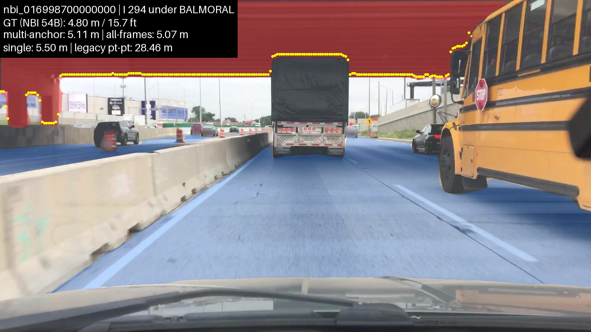
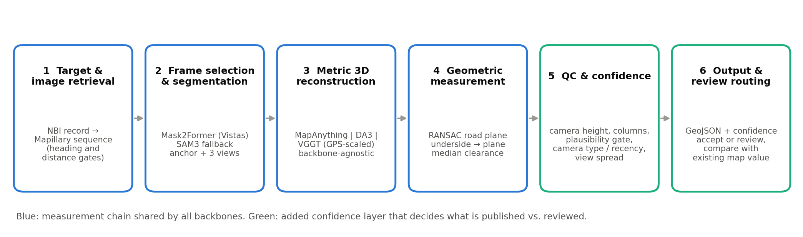
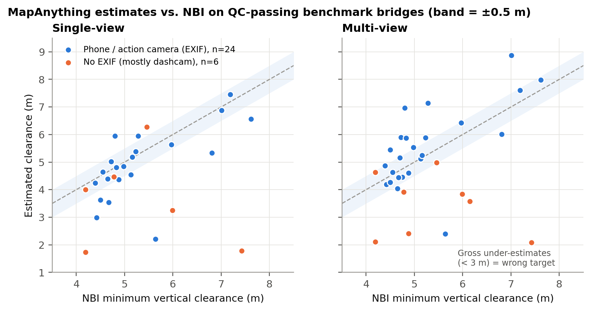
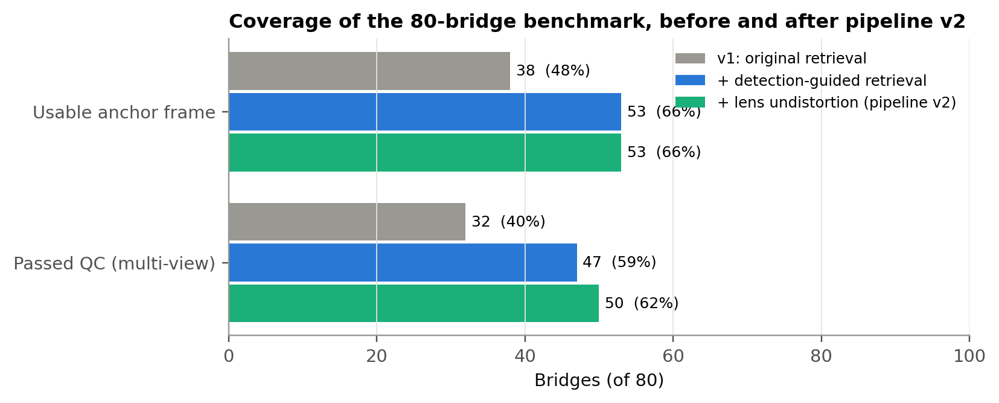
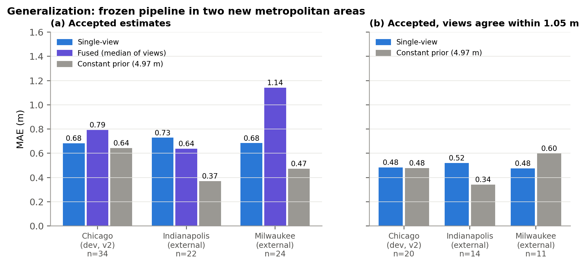
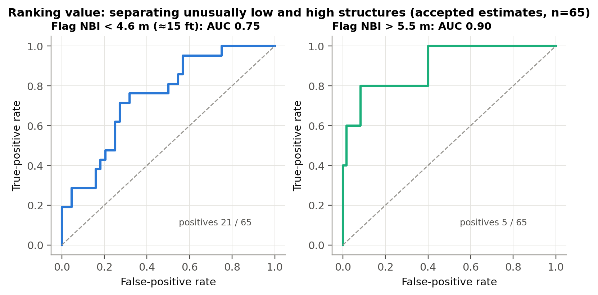

<h1 align="center">Measuring Bridge Clearance from Street-Level Imagery</h1>

<p align="center">
  <b>Real-world dimension and metric estimation of physical features with 3D reconstruction and computer vision</b><br>
  UChicago MS in Applied Data Science · Capstone with HERE Technologies · 2026
</p>

<p align="center">
  
  
  
  
</p>

<p align="center">
  
  <br><sub>Bridge (red) and road (blue) found automatically; the yellow line is the underside used for the clearance measurement.</sub>
</p>

<p align="center">
  📄 <a href="paper/HERE_Capstone_Final_Paper_V3.docx"><b>Final paper</b></a> &nbsp;·&nbsp;
  🎤 <a href="presentation/Capstone_Final_Presentation.pdf"><b>Presentation</b></a> &nbsp;·&nbsp;
  📊 <a href="results/"><b>Results</b></a> &nbsp;·&nbsp;
  🧪 <a href="notebooks/"><b>Notebooks</b></a>
</p>

---

## Overview

Map attributes such as **bridge vertical clearance** matter for truck routing, but they are collected with LiDAR surveys and field audits, which are expensive to repeat across a network. We asked whether **crowd-sourced Mapillary imagery that already exists** can estimate them in metres.

We built an automated pipeline that does the following for each bridge:

1. Retrieves the Mapillary sequence approaching the bridge.
2. Segments the bridge and road.
3. Reconstructs metric 3D geometry with a swappable backbone: **MapAnything**, **Depth Anything 3** or **VGGT**.
4. Measures the deck underside against a RANSAC-fitted road plane.
5. Decides **accept / review / reject** without using ground truth.

Ground truth is the FHWA National Bridge Inventory, Item 54B.

<p align="center"></p>

## Key results

| | Result |
|---|---|
| **Accuracy** (80-bridge Chicago benchmark, MapAnything single-view) | **0.43 m** median error · 0.92 m MAE · 0.65 m on phone / action cameras |
| **Coverage** (pipeline v2: detection-guided retrieval + lens undistortion) | **40% → 62.5%** of bridges measured · accepted 22 → 34 |
| **Held-out** (51 Chicago bridges, frozen rules) | MAE 0.87 → **0.73 m**, 84% kept · 0.62 m with view agreement |
| **New cities** (120 bridges, Indianapolis + Milwaukee, no retuning) | **0.70 m** MAE, 80% within 1 m (Chicago: 0.68 m) |
| **Ranking** (screening value) | AUC **0.75** for < 4.6 m · AUC **0.90** for > 5.5 m |
| **Cost** | ≈ 6 s per bridge on one L4 GPU |

On absolute error, the estimates do not yet beat a constant regional median (4.97 m), because most overpasses sit in a narrow 4.3–5.2 m band. Their value is in **ranking and discrepancy detection**. We therefore recommend a low-cost **screening layer** for HERE, not a replacement value.

<table>
  <tr>
    <td width="50%"><br><sub><b>MapAnything vs NBI</b> on QC-passing bridges (band ±0.5 m)</sub></td>
    <td width="50%"><br><sub><b>Pipeline v2</b>: smarter retrieval and undistortion lift coverage</sub></td>
  </tr>
  <tr>
    <td width="50%"><br><sub><b>Generalization</b>: frozen pipeline in two new metro areas</sub></td>
    <td width="50%"><br><sub><b>Screening value</b>: flagging unusually low and high bridges</sub></td>
  </tr>
</table>

## Team

| Member | Main work |
|---|---|
| **Kely Zhang** | MapAnything backbone. 80-bridge NBI benchmark and its expanded version. Pipeline v2: detection-guided retrieval, lens undistortion, camera rules, plausibility gate, held-out and external-metro tests. Stop signs. Paper analysis and figures. |
| **Anna Chen** | Depth Anything 3 backbone (single- and multi-view). Mask2Former vs SAM3 segmentation comparison. |
| **Adaora Ezike** | VGGT backbone and scale diagnostics. |

Advisor: **Dr. Jeanette Shutay**

## Repository layout

```
paper/
  HERE_Capstone_Final_Paper_V3.docx     final paper (drafts/ has V1, V2, spring paper)
  build/                                scripts + data that regenerate every paper figure
    figures.py, figures_v2.py, fig_metros*.py, analysis_v2.py, prep.py, summ_ext.py
    build.js, content_final.js          docx builder (docx npm package)
    data/  figs/  anna_figs/            slim result tables, rendered figures, DA3 figures
presentation/
  Capstone_Final_Presentation.pdf       final deck (speaker script in the Google Slides notes)
  build_deck.gs                         Apps Script that builds the deck in Google Slides
docs/                                   proposals, weekly update log
notebooks/
  01_spring_exploration/                MapAnything / Pi3 / SAM3 / Mapillary API prototyping
  02_depth_anything_3/                  DA3 experiments (Anna)
  03_mapanything_nbi_benchmark/         MapAnything vs NBI benchmark (Kely)
  04_pipeline_v2/                       retrieval, undistortion, held-out and metro experiments (Kely)
  05_vggt/                              VGGT benchmark (Adaora)
results/
  benchmark_80/                         per-bridge results, metrics, NBI candidates, example overlays + 3D viewer
  mapanything/                          MapAnything results, error map, GeoJSON of estimates
  pipeline_v2/                          crossing experiment, Indianapolis and Milwaukee cases
  stop_signs/                           stop-sign widths vs MUTCD sizes
  vggt/                                 VGGT results, metrics, scale diagnostics
```

## Reproducing the paper figures

```bash
cd paper/build
pip install numpy pandas matplotlib scipy scikit-learn
DATADIR=data/ FIGDIR=figs/ python figures.py      # core figures
DATADIR=data/ FIGDIR=figs/ python figures_v2.py   # pipeline v2 figures
DATADIR=data/ FIGDIR=figs/ python fig_metros2.py  # external-metro figure
```

`analysis_v2.py` recomputes the statistics and overwrites `data/results_v2.json`.

The notebooks run the full pipeline end to end. They were written for Google Colab with a GPU (L4 or A100). They need `MAPILLARY_TOKEN` and `HF_TOKEN` set as environment variables or Colab secrets. Every hard-coded token has been replaced with a placeholder.

An interactive example of the multi-anchor 3D reconstruction is in [`results/benchmark_80/examples/`](results/benchmark_80/examples/). Download the `.html` file and open it in a browser.

## Data sources

- **Imagery:** [Mapillary API v4](https://www.mapillary.com/developer), licensed CC BY-SA.
- **Ground truth:** [FHWA National Bridge Inventory 2025](https://www.fhwa.dot.gov/bridge/nbi/2025/delimited/), Item 54B (minimum vertical underclearance). We used the IL, IN and WI delimited files; download them from FHWA.
- **Stop signs:** MUTCD R1-1 standard sizes, 30 in and 36 in.

## Not included

- **Three notebooks over 10 MB**, which are too large to export with our tooling:
  - `kely_sam3-mapanything.ipynb`
  - `OpenD4RT_Capstone_Demo.ipynb`
  - `SAM3D_Capstone_Official_API_Demo.ipynb`

  These can be added with their outputs stripped (`nbstripout`).
- **Bulk per-bridge artifacts** (about 100 MB per run): raw Mapillary images, every overlay and 3D viewer, and run logs. One example of each is kept in `results/benchmark_80/examples/`.
